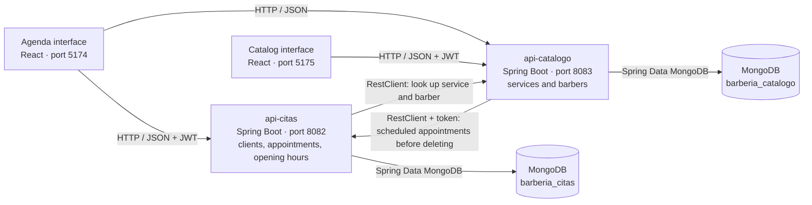

# Barbershop management system

Third-term project (final prototype) for **Solution Design** — Systems Engineering.
Group 8: Daniel Felipe Vanegas and Camilo Andrés Paternina.

The barbershop books appointments: each appointment joins a client, a service and a barber.
The system is two Spring Boot microservices, each with its own **MongoDB** database, and two
web interfaces that consume them. Every write is protected with **JWT** and roles.

## Architecture



| Part | Folder | What it does |
|---|---|---|
| api-catalogo | `api-catalogo/` | CRUD for the services the barbershop offers and for the barbers. |
| api-citas | `api-citas/` | CRUD for clients and appointments, and the opening hours. To book, it looks up the service and the barber in api-catalogo. |
| Agenda interface | `interfaces/agenda/` | First interface, for the front desk: today's schedule per barber, appointments and clients. |
| Catalog interface | `interfaces/catalogo/` | Second interface, for the owner: services with price and duration, and barbers. |
| Shared code | `interfaces/compartido/` | API calls, session, layout, components and styles used by both interfaces. |

Each microservice runs separately, has its own controllers and owns its database: neither
reads the other's collections.

## Database: MongoDB

Both microservices use a local MongoDB server (`mongodb://localhost:27017`) through Spring
Data MongoDB: `@Document` classes, `@Id String id` (an `ObjectId` generated by MongoDB) and
`MongoRepository` interfaces whose queries come from the method names.

| Database | Collection | Document |
|---|---|---|
| `barberia_catalogo` | `servicios` | `nombre` (unique index), `descripcion`, `precio`, `duracionMinutos`, `activo` |
| `barberia_catalogo` | `barberos` | `nombre`, `documento` (unique index), `telefono`, `especialidad`, `activo` |
| `barberia_citas` | `clientes` | `nombre`, `documento` (unique index), `telefono`, `correo` |
| `barberia_citas` | `citas` | `fechaHora` (index), `estado`, `observaciones`, references and copies (below) |
| `barberia_citas` | `horario` | one document with the seven days embedded |

An appointment as stored in `citas`:

```json
{
  "_id": { "$oid": "6735f0c2a1b2c3d4e5f60720" },
  "fechaHora": { "$date": "2026-11-20T10:00:00Z" },
  "estado": "PROGRAMADA",
  "clienteId": "6735f0c2a1b2c3d4e5f60730",
  "clienteNombre": "Carlos Ramírez",
  "servicioId": "6735f0c2a1b2c3d4e5f60718",
  "servicioNombre": "Corte clásico",
  "precio": 25000,
  "duracionMinutos": 30,
  "barberoId": "6735f0c2a1b2c3d4e5f6071a",
  "barberoNombre": "Andrés Rojas"
}
```

### References and embedded documents

- **Appointment → client, service, barber: manual references.** The appointment keeps the
  `ObjectId` of each one (not `@DBRef`). The client lives in the same database; the service
  and the barber live in the other microservice's database, so the only way to reach them is
  its API. Next to each reference goes a copy of what is shown (name, price, duration): the
  appointment keeps what it cost when it was booked, even if the catalog changes later.
- **Opening hours → days: embedded.** It is a bounded one-to-many (always seven days) that is
  always read and changed with the week, so `horario` has a single document:

```json
{
  "_id": "semanal",
  "dias": [
    { "diaSemana": 1, "apertura": "09:00", "cierre": "19:00" },
    { "diaSemana": 7, "apertura": null, "cierre": null }
  ]
}
```

- If a client is renamed, their appointments get the new name. If a client is deleted, their
  past appointments keep the name and `clienteId` becomes `null`.
- Appointment dates are stored as the local time they were booked with (the barbershop works
  in a single time zone), so Compass shows the same hour as the interface.

Each microservice creates its indexes when it starts (`spring.data.mongodb.auto-index-creation`)
and loads the demo data only into empty collections (`config/DatosIniciales.java`). The data
survives restarting the microservices and the MongoDB server.

## Security: JWT and roles

Both microservices are OAuth2 resource servers (`spring-boot-starter-security-oauth2-resource-server`).
`POST /api/auth/login` checks the user and password and returns a token signed with HMAC-SHA256:

```json
{ "token": "eyJhbGciOiJIUzI1NiJ9...", "tipo": "Bearer", "usuario": "admin", "rol": "ADMIN", "expira": "..." }
```

The token goes in every request as `Authorization: Bearer <token>`. Both microservices sign and
validate with the same key (`jwt.secreto`), so a token from either one is accepted by the other.
It lasts 8 hours. The roles travel in the `roles` claim.

| User | Password | Role | Can do |
|---|---|---|---|
| `admin` | `123456` | `ADMIN` | Everything |
| `recepcion` | `123456` | `USER` | Clients and appointments, except deleting clients. Only reads the catalog. |

| Endpoint | Access |
|---|---|
| `POST /api/auth/login`, `GET /api/status`, Swagger | Public |
| `GET /api/servicios/**`, `GET /api/barberos/**` | Public (prices and barbers; api-citas reads them when booking) |
| `POST`, `PUT`, `DELETE` on services and barbers | `ADMIN` |
| `/api/clientes/**`, `/api/citas/**` | `ADMIN` or `USER` |
| `DELETE /api/clientes/{id}`, `PUT /api/horario/{dia}` | `ADMIN` |
| `GET /api/horario`, `GET /api/conexion/catalogo` | Public |

Without a token, or with an expired or altered one, the answer is `401`; with a token whose
role is not enough, `403`. Both come as `{"mensaje": "..."}`.

## Communication between microservices

To book an appointment the client sends only the IDs:

```json
{
  "clienteId": "6735f0c2a1b2c3d4e5f60730",
  "servicioId": "6735f0c2a1b2c3d4e5f60718",
  "barberoId": "6735f0c2a1b2c3d4e5f6071a",
  "fechaHora": "2026-12-01T10:00"
}
```

1. `CitaController` receives the `POST /api/citas` and `@Valid` checks the body.
2. `CitaService` looks up the client in the `clientes` collection.
3. `CatalogoCliente` sends `GET /api/servicios/{id}` and `GET /api/barberos/{id}` to api-catalogo with `RestClient`.
4. With the three answers the appointment is checked against the opening hours and the
   other appointments, saved in MongoDB and answered with `201`.

The communication is synchronous: api-citas waits for api-catalogo before continuing. If
api-catalogo is down, api-citas answers `503` with a clear message and the rest of its
endpoints keep working.

It also goes the other way: before deleting a service or a barber, `CitasCliente` in
api-catalogo asks api-citas for its scheduled appointments
(`GET /api/citas?barberoId={id}&estado=PROGRAMADA`). That endpoint needs a token, so
`RestClientConfig` forwards the administrator's token from the original request. If there
are scheduled appointments the delete is rejected with `409`; if api-citas is down, with `503`.

Each microservice has the other's URL in `application.properties` (`api.catalogo.url` and
`api.citas.url`), not in the code.

## How to run

Requirements: **JDK 17 or later**, **Node.js 20 or later** and **MongoDB Community Server**
running on port 27017 (installed as a Windows service, it starts on its own). **MongoDB
Compass** is optional, to look at the data. Maven is not needed: each microservice ships its
own wrapper (`mvnw`).

Open four terminals at the repository root.

**1. api-catalogo** (port 8083)

```bash
cd api-catalogo
./mvnw spring-boot:run
```

**2. api-citas** (port 8082)

```bash
cd api-citas
./mvnw spring-boot:run
```

**3 and 4. The interfaces** (ports 5174 and 5175)

```bash
cd interfaces
npm install
npm run agenda
```

```bash
cd interfaces
npm run catalogo
```

On Windows (PowerShell or CMD) the wrapper is called `.\mvnw.cmd`.

| Address | What is there |
|---|---|
| http://localhost:5174 | Agenda interface |
| http://localhost:5175 | Catalog interface |
| http://localhost:8083/swagger-ui.html | Swagger for api-catalogo |
| http://localhost:8082/swagger-ui.html | Swagger for api-citas |

The databases are created with their demo data the first time each microservice starts. To
see them, connect Compass to `mongodb://localhost:27017`.

The interfaces have to run on ports 5174 and 5175: they are the only origins the
microservices accept through CORS (`frontend.url` in each `application.properties`).

Optional environment variables: `MONGODB_URI` (another MongoDB server) and `JWT_SECRETO`
(the signing key, at least 32 characters, the same in both microservices). The default key
is only for running locally.

## Swagger

Each microservice documents its endpoints with springdoc-openapi: `@Tag` per controller,
`@Operation` and `@ApiResponses` on every endpoint, `@Parameter` on path and query parameters,
and `@Schema` with examples on every DTO field.

To try a protected endpoint from Swagger: run `POST /api/auth/login`, copy the `token`, press
**Authorize** and paste it.

## REST API

The full table of endpoints per controller is in
[docs/endpoints.pdf](docs/endpoints.pdf) (also in Word: `docs/endpoints.docx`).

The four resources follow the same scheme:

| Method | Endpoint | Operation |
|---|---|---|
| `POST` | `/api/{resource}` | Create |
| `GET` | `/api/{resource}` | List |
| `GET` | `/api/{resource}/{id}` | Get one |
| `PUT` | `/api/{resource}/{id}` | Update |
| `DELETE` | `/api/{resource}/{id}` | Delete |

`{resource}` is `servicios` or `barberos` in api-catalogo, and `clientes` or `citas` in
api-citas. `{id}` is the document's `ObjectId`. In addition:

- `POST /api/auth/login` on each microservice returns the JWT.
- `GET /api/citas` accepts optional filters, applied inside the MongoDB query: `clienteId`,
  `barberoId`, `servicioId`, `estado` and `fecha` (`2026-11-20`).
- `PATCH /api/citas/{id}/estado` changes only an appointment's status (complete or cancel).
- `GET /api/horario` returns the opening hours of the seven weekdays, and
  `PUT /api/horario/{diaSemana}` changes one day (`{"apertura": "09:00", "cierre": "19:00"}`,
  or both `null` to close it).
- `GET /api/conexion/catalogo` checks, from api-citas, that api-catalogo responds.
- `GET /api/status` on each microservice.

Errors always arrive as `{"mensaje": "..."}` with the matching code: `400` invalid data,
`401` no valid token, `403` role not allowed, `404` not found, `409` conflicts with a business
rule, `503` the other microservice did not respond. Validation errors also say what failed in
each field:

```json
{
  "mensaje": "El precio debe ser mayor que cero.",
  "errores": {
    "precio": "El precio debe ser mayor que cero.",
    "duracionMinutos": "La duración debe estar entre 5 y 240 minutos."
  }
}
```

### JSON and XML

The services' `GET` endpoints return JSON or XML depending on the `Accept` header:

```bash
curl -H "Accept: application/xml" http://localhost:8083/api/servicios
```

## Business rules

- An appointment is only booked with a service and a barber that are **active** in the catalog.
- Appointments are not booked on a past date.
- An appointment has to start and end within the **opening hours** of its day: Monday to
  Saturday from 9:00 to 19:00, closed on Sunday (the demo data; they are changed with
  `PUT /api/horario/{diaSemana}`). The hours cannot change if a scheduled appointment would
  fall outside them.
- Neither a barber nor a client can have two scheduled appointments that overlap. The
  overlap is computed with the service's duration.
- An appointment starts as `PROGRAMADA` (scheduled) and can only move to `COMPLETADA`
  (completed) or `CANCELADA` (cancelled). It can only be completed once its time has come.
  Once closed it is not modified.
- The appointment keeps the service's name, price and duration it was booked with. Editing
  it with the same service keeps them, even if the service later changed or was deactivated.
- A client with scheduled appointments is not deleted. When a client is deleted, their past
  appointments keep the client's name.
- A service or a barber with scheduled appointments is not deleted; it can be deactivated
  instead, so it gets no new bookings.
- Client and barber ID documents and service names are not repeated (checked in the service
  and guaranteed by unique indexes). Phone numbers, when given, have 7 to 10 digits.

The format of each field is checked with Bean Validation on the DTOs (`@NotBlank`, `@Size`,
`@Positive`, `@Min`, `@Max`, `@Pattern`) and `@Valid` in the controllers. The rules that depend
on the stored data are in the services and answer `409`.

## Structure of each microservice

```
controller/   REST endpoints, login and the error handler (@RestControllerAdvice)
service/      business rules and token issuing
repository/   MongoRepository interfaces
model/        MongoDB documents (@Document) and the embedded day of the opening hours
dto/          what the API receives (DTORequest, with validations) and returns (DTOResponse, MensajeDTO)
cliente/      communication with the other microservice
config/       security, JWT, CORS, RestClient, Swagger, MongoDB and demo data
```

## What we applied from each class

| Topic | Where it is |
|---|---|
| Microservices | Two independent Spring Boot applications, each with its own port and database. |
| NoSQL and MongoDB | One database per microservice, documents with `ObjectId`, unique indexes. |
| Spring Data MongoDB | `@Document`, `@Id`, `MongoRepository` with derived queries (`existsByDocumentoAndIdNot`, `findByEstadoAndFechaHoraBetween`) and `MongoTemplate` with `Criteria` for the appointment filters. |
| Embedded vs references | Days embedded in `horario`; manual references by id from `citas` to clients, services and barbers. |
| CRUD | `POST`, `GET`, `PUT`, `PATCH` and `DELETE` with `ResponseEntity` and their codes (`201`, `200`, `400`, `404`, `409`). |
| Spring Security and JWT | `SecurityFilterChain`, stateless sessions, `permitAll` / `hasRole` / `hasAnyRole`, users with `BCryptPasswordEncoder`, login that returns a Bearer token. |
| Roles | `ADMIN` and `USER`; the interfaces hide what the role cannot do and the API answers `403`. |
| Unit and integration tests | JUnit 5 and Mockito for the services; `@WebMvcTest` with MockMvc for routes, validation and security. |
| Validation and errors | DTO validations with `@Valid`, `MethodArgumentNotValidException` → `400` per field, business rules → `409`. |
| Documentation | Swagger with `@Tag`, `@Operation`, `@ApiResponses` and examples; this README; `docs/endpoints.pdf`. |
| Synchronous communication | `CatalogoCliente` in api-citas and `CitasCliente` in api-catalogo, with `RestClient`. |

We use Spring Boot 4, which ships Jackson 3 and renames some settings: the MongoDB address is
`spring.mongodb.uri` (it used to be `spring.data.mongodb.uri`) and the XML dependency is
`tools.jackson.dataformat:jackson-dataformat-xml`.

## Interfaces

Built with React and Vite, with no component library. The two interfaces are npm workspaces
in `interfaces/`: each one has its own pages and port, and both import the shared package
`@barberia/compartido` (API calls, session, layout, components and plain-CSS styles). The
barbershop is called El Remolino.

- **Login.** Each interface opens with user and password. The token is kept in the browser
  until it expires; when the API rejects it, the interface asks to log in again.
- **Agenda (first interface).** Hoy is the day's schedule: one column per active barber and
  the opening hours going down; clicking a free slot books that time with that barber. Next
  to it are the next appointment with its actions, the day's totals and the upcoming
  appointments. Citas shows each appointment as a ticket, grouped by day, with a search and
  a status filter. Clientes has a table, a search, a form to create and edit, and a
  confirmation before deleting (only for the administrator).
- **Catalog (second interface).** Servicios and Barberos with a table, a search, a form and a
  confirmation before deleting. Logged in as front desk it is read-only.
- The appointment form shows the opening hours and what the barber already has booked that
  day, and warns about an overlap or a time outside the opening hours before saving. It
  also lets you create a client without leaving it.
- The forms validate before submitting and show the API's message when it rejects the
  operation.
- The status of both microservices and of the call between them is visible at the bottom of
  the sidebar. If one does not respond, the interface explains what can and cannot be done
  and recovers on its own when it comes back.
- Each sidebar links to the other interface. Light and dark theme, skeletons while loading,
  small-screen layout and the reduced-motion preference.

## Tests

```bash
cd api-catalogo && ./mvnw test
cd api-citas && ./mvnw test
```

There are 50 tests and none needs MongoDB:

- **Unit tests with Mockito** (`@ExtendWith(MockitoExtension.class)`, `@Mock`, `@InjectMocks`)
  for the services: booking rules, overlaps, opening hours, repeated documents, deleting with
  scheduled appointments and the other microservice being down.
- **Controller tests with `@WebMvcTest` and MockMvc**, with the services replaced by
  `@MockitoBean`: routes, response codes, `@Valid` messages per field, XML, CORS, `401`
  without a token and `403` with the wrong role. In api-catalogo one class logs in for real
  and uses the token it gets.

## Scope

- Users live in memory (`SeguridadConfig`); there is no user management.
- The opening hours are per weekday; public holidays are not modeled.
- The system runs locally.
